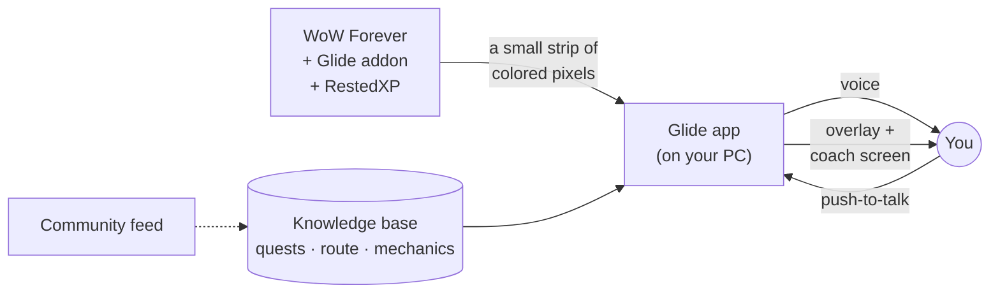

# Glide

**A coach in your ear for leveling in WoW Forever.**
 
Follow your RestedXP guide, and Glide tells you why each step matters, what has changed and what to do next.

[**Download**](https://github.com/Fermin7c1/Glide-releases/releases/latest) ·
[Features](#features) ·
[Getting started](#getting-started) ·
[FAQ](#faq) ·
[Technical guide](docs/TECHNICAL.md)

---

## Why Glide

Speedrunners reach 60 in a fraction of the time most of us take. That isn't because they press buttons faster.
They know things: which quest to skip, when to grind two bars instead of running across the zone, which turn-ins to
hold for later, where a flight path saves four minutes, and what Blizzard quietly changed last patch.

[RestedXP](https://www.restedxp.com) already gives you the route. Glide gives you the speedrunner sitting next to
you. It watches your game as you play, knows every step of your RestedXP guide inside out, and talks to you at the
moments that matter. You keep your eyes on the game and your hands on the keys. You don't need to read patch notes,
watch hours of routing videos or memorize anything. **You just glide to 60.**

> *"Grab the flight path before you leave town, you'll be back here at 22. And you're half a bar from 12:
> finish the boars on the way and your new rank of Heroic Strike is waiting at the trainer."*
>
> That's the kind of thing Glide says.

## Features

### 🧭 It knows the route, and why

- **Every RestedXP step, explained.** Glide models your guide against the game's own data, so for each step it knows
  how much XP it gives, how long it takes, what depends on it and what you could do instead. Ask "why are we doing
  this?" and you get a real answer.
- **Off course? It notices.** Wander off the route, get stuck or go the wrong way, and you get a nudge with real
  directions: yards, compass bearing and landmarks, relative to where your character is facing.
- **Quest briefings.** Pick up a quest and Glide tells you how to do it: where the targets are, what drops the items,
  and what the route does with it next. Pick up a hub's worth of quests and it holds each briefing until you get there.
- **The guide's videos, summed up.** When a RestedXP step links a "click here for an example" clip, Glide tells you
  what the clip shows, so you don't have to alt-tab to YouTube in the middle of a pull.

### ⚡ The speedrunner's instincts

- **Pace you can feel.** Your XP per hour, tracked live and compared with a strong RestedXP run, with a review now and
  then of where the time went.
- **The small stuff, never forgotten.** New spell ranks at the trainer, unspent talent points (with the next pick from
  RestedXP's leveling build), a flight master you've walked past without talking to, running low on food, drink or ammo,
  a mob someone else already tapped.
- **Gear, decided for you.** When a quest offers rewards, Glide says which one to take, scored with RestedXP's stat
  weights for your class and level. A bag drop that's an upgrade gets called out the moment you're out of combat.
- **Buffs on a leash.** A reminder before your long buffs expire, and a "rebuff" call when one drops. Say "remind me
  to reapply Battle Shout" and it's on the watch list.
- **Vendor treasures.** Limited-stock gear and potions worth buying, flagged when you're near the vendor.
- **Death, handled.** Corpse distance versus the spirit healer, so you take the faster way back.

### 🗣️ Talk to it

- **Push-to-talk.** Hold **F8** in game, ask your question out loud, let go. The answer is spoken back in a couple of
  seconds. Speech recognition can run entirely on your own PC.
- **Reminders in plain words.** "Remind me to repair when I'm near a vendor." "When I get to Ironforge, remind me to
  train." "Remind me in 20 minutes to check the auction house."
- **It remembers you.** Tell Glide how you like to be coached ("less chatter in dungeons", "I'm going for the Hardcore
  route") and it keeps that from one session to the next.
- **Your volume, your topics.** Mute any kind of commentary (route, combat, buffs, gear, pace, upkeep, voice) from the
  in-game Glide window, the minimap button or `/coach`. Answers to your own questions always come through.

### 📰 Up to date when you aren't

- **Community intel.** WoW Forever keeps changing. Glide brings in a curated feed of leveling-relevant findings
  (XP changes, quest fixes, respawn rates, routes, class power) from developer notes, blue posts, bug trackers, wikis
  and the community. Each finding is marked as reported, corroborated or official, and the coach says when something
  is only a rumor.
- **Forever's own quests.** Glide's quest database knows which quests are new or changed in Forever, and the addon
  records what the server actually sends while you play.
- **When RestedXP updates, Glide keeps up.** It reads the new guide version at the next login and rebuilds its
  knowledge in the background while you play.

### 🛠️ Quality of life in game

- **Auto repair** at any repair vendor (with your own gold, only when you can pay the whole bill).
- **Bag cleanup** when your bags are full.
- **"New at your trainer"**: a window at level-up showing exactly which spell ranks you can buy now.
- **A click-through overlay** with the current step, over the game.

## How it works

The Glide addon reads your game through the normal addon API and draws your live state as a small strip of colored
cells in the corner of the WoW window. The Glide app reads those pixels off the screen, works out what's going on and
decides what's worth saying. Nothing reads the game's memory, and nothing presses keys for you: you play, Glide
coaches.

The coach can use an AI model of your choice for natural conversation. Without one, Glide still runs fully offline
with rule-based callouts.

## Getting started

### What you need

- Windows 10 or 11.
- WoW Forever, in **Windowed** or **Windowed (Fullscreen)** mode. Exclusive fullscreen can hide the strip from capture.
- The [RestedXP](https://www.restedxp.com) addon. The free Forever guides work; premium guides work too.

### Install

1. **Download** the latest `Glide-to-60-Setup-<version>.exe` from
   [Releases](https://github.com/Fermin7c1/Glide-releases/releases/latest) and run it. It's a per-user install with
   its own Python bundled, so there's nothing else to set up.
   > The installer isn't code-signed yet, so Windows SmartScreen may say "Unknown publisher". Click **More info**,
   > then **Run anyway**.
2. **Point Glide at your WoW folder.** It looks for it by itself. Then let it install the Glide addon for you.
3. **(Optional) Add an AI key** in the app's settings for a conversational coach. Supported: Anthropic (Claude),
   Google Gemini, OpenAI, OpenRouter, Groq, or any OpenAI-compatible server, including models on your own PC.
   Optional voice and search services (ElevenLabs, Google TTS, Deepgram, Brave, Tavily) plug in the same way.
4. **Log in and play.** Glide starts talking when there's something worth saying.

Glide updates itself: when a new version is out, one click installs it.

### In game

| | |
|---|---|
| `/glide` or left-click the minimap button | Opens the Glide window with every switch |
| Right-click the minimap button | Commentary on or off |
| `/coach` | What the coach talks about (`/coach gear off`, `/coach reset`, …) |
| **F8** (hold, while WoW is focused) | Ask the coach a question out loud |
| `/glide mark [note]` | Flag a moment so the coach learns from it |

## FAQ

<b>Do I need RestedXP?</b>

Yes. Glide is built on top of the RestedXP guides: it coaches you along that route rather than replacing it. The free
WoW Forever guides are enough.

<b>Do I need to pay for an AI model?</b>

No. Without a key, Glide runs fully offline with rule-based callouts for the route, combat, gear, buffs and upkeep.
A model makes it conversational: you can ask it anything and it explains itself in its own words. You pay your
provider directly, or you run a free local model through any OpenAI-compatible server.

<b>Does it play the game for me?</b>

No. Glide never sends input to the game and never reads its memory. The addon uses only the normal addon API (the
same one RestedXP uses), and the app reads pixels that the addon draws on your own screen. You do the playing.

<b>What leaves my PC?</b>

Glide has no telemetry and no account. Everything runs on your PC, and the app's local server only listens to your
own machine. Your API keys are stored encrypted with Windows' own data protection. Glide downloads updates and the
community feed. If you add an AI key, what the coach needs to answer (your game state and your question) goes to the
provider you picked, and only that provider ever gets that provider's key.

<b>Mac or Linux?</b>

Not yet. The app is Windows-only for now: screen capture, voice and the key handling use Windows features.

<b>Does it work outside WoW Forever?</b>

Glide is tuned for WoW Forever: its quest data, mechanics and community intel are all about Forever.

## Contributing

Bug reports, ideas and pull requests are welcome. [CONTRIBUTING.md](CONTRIBUTING.md) explains how to run the engine
and the tests, and [docs/TECHNICAL.md](docs/TECHNICAL.md) explains how every part works. To report a security problem,
please don't open a public issue: use GitHub's private vulnerability reporting on this repository.

## Acknowledgments

Glide stands on the shoulders of the WoW community:

- [**RestedXP**](https://github.com/RestedXP/RXPGuides): the guides, stat weights and talent builds Glide coaches along.
- [**ForeverGuide**](https://github.com/prezus/ForeverGuide) and [**Questie**](https://github.com/Questie/Questie):
  quest, NPC and object data.
- [**ForeverQuestMarker**](https://github.com/Swafox/ForeverQuestMarker): which quests are new in Forever.
- [**Cpt. Stadics' Map of Vendor Treasures**](https://www.curseforge.com/wow/addons/cpt-stadics-map-of-vendor-treasures):
  vendors worth visiting.
- [**wowdev**](https://github.com/wowdev): WoWDBDefs and TACTKeys, for reading the game's own files from your install.
- [Lucide](https://lucide.dev) icons, and the Tenor Sans, Geist and Source Serif 4 fonts.

Each keeps its own license: see [THIRD_PARTY_NOTICES.md](THIRD_PARTY_NOTICES.md).

## License

Glide is free software under the [GNU General Public License v3.0 or later](LICENSE).

---

Glide is a fan project, not affiliated with or endorsed by Blizzard Entertainment or RestedXP. World of Warcraft
and Blizzard Entertainment are trademarks of Blizzard Entertainment, Inc. No Blizzard game files ship with Glide:
the game data it uses is read at runtime from your own installation.
